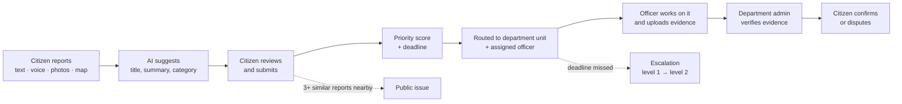
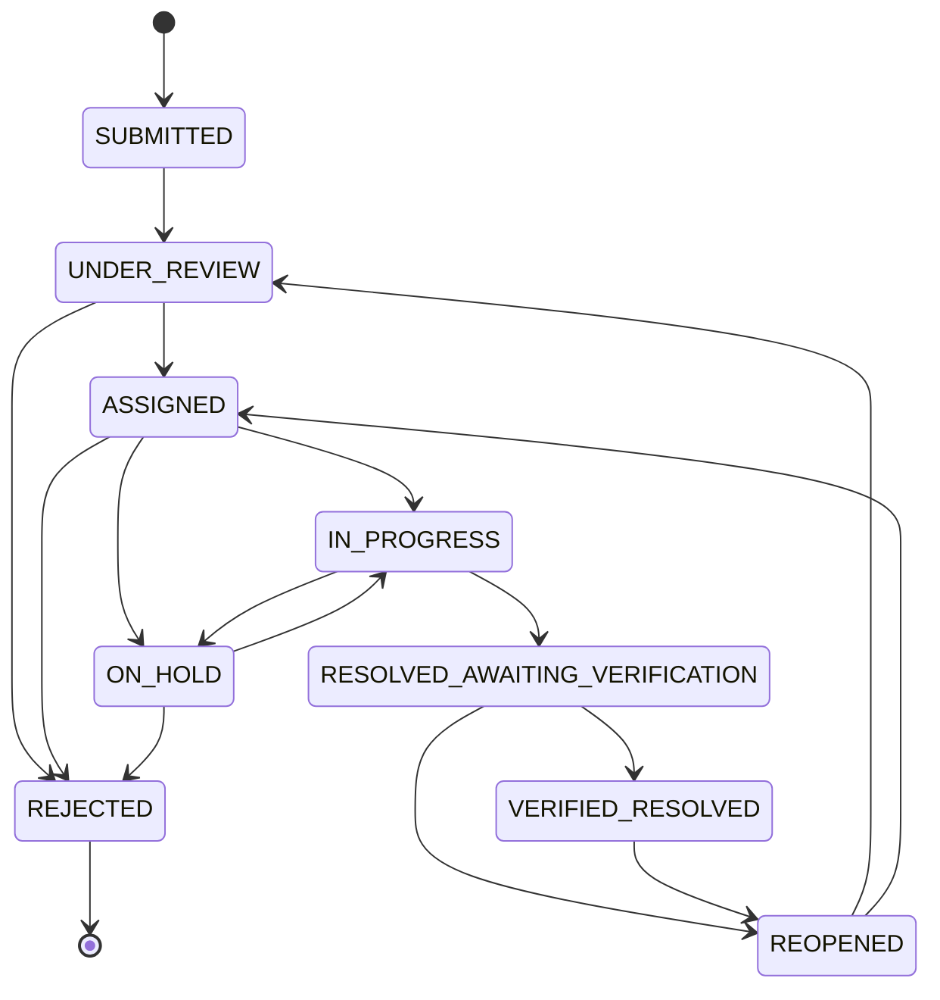
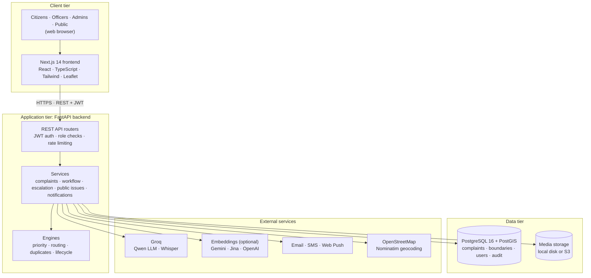

<div align="center">

# CivicConnect

### From Citizen Complaints to Accountable Action

**An AI-assisted civic grievance management platform that connects citizens with the right government department, tracks every complaint to a verified fix, and makes recurring problems visible to the public.**

[**Live Website**](https://civic-connect-pearl-omega.vercel.app/) · [**Demo Video**](https://YOUR-DEMO-VIDEO-LINK) · [**API Docs**](https://civicconnect-api-26zp.onrender.com/docs)

     

</div>

> **Try it quickly:** open the live website and click **Explore demo**. You can sign in as a Citizen, Officer, Department Admin or Main Admin with one click. The demo uses sample data for Hubballi-Dharwad and is kept separate from live data.
>
> The backend runs on Render's free tier, so the first request after a period of inactivity can take about a minute while the server wakes up.

---

## Table of contents

1. [Overview](#overview)
2. [Problem statement](#problem-statement)
3. [Proposed solution](#proposed-solution)
4. [Key features](#key-features)
5. [User roles](#user-roles)
6. [How it works](#how-it-works)
7. [System architecture](#system-architecture)
8. [Tech stack](#tech-stack)
9. [Getting started](#getting-started)
10. [Project structure](#project-structure)
11. [Testing](#testing)
12. [Future work](#future-work)
13. [Team](#team)
14. [Final note](#final-note)

---

## Overview

Every day, residents run into potholes, broken streetlights, leaking water lines, overflowing garbage and blocked drains. Reporting these problems is often harder than it should be. People don't know which office is responsible, complaint forms expect formal written English, and once a complaint is filed there is no clear way to know whether anyone is working on it.

**CivicConnect** is a full-stack web platform that closes this gap. A citizen can describe a problem in their own language, by typing or by speaking, attach photos, audio or video, and pin the exact spot on a map. Generative AI turns that input into a clear, structured complaint. The platform then:

- sends it to the department responsible for that category in that exact area;
- assigns it to the officer covering the location with the lightest workload;
- gives it an explainable priority score and a deadline;
- escalates it automatically if the deadline is missed;
- requires photo evidence and admin verification before it counts as resolved;
- lets the citizen confirm the fix or dispute it.

When many residents report the same problem in one area, CivicConnect groups them into a **public issue** that anyone can follow without logging in.

AI in CivicConnect **only makes suggestions**. Routing, priority, escalation and publication follow fixed rules that can be explained, and people make the final decisions.

---

## Problem statement

Civic grievance handling breaks down at several points.

| # | Problem | Effect on citizens and authorities |
|---|---|---|
| 1 | **Citizens don't know which department handles an issue** | Complaints land in the wrong office and are forwarded or ignored |
| 2 | **Complaints come in many languages and lack details** | Officers receive vague reports with no exact location or evidence |
| 3 | **No transparent tracking** | Citizens can't see progress, so they file again or give up |
| 4 | **No sense of urgency** | A dangerous open drain near a school waits behind minor requests |
| 5 | **Work is closed without proof** | Complaints are marked "resolved" even when nothing was fixed |
| 6 | **Many people report the same problem separately** | Duplicate work for staff, and the real scale of the issue stays hidden |
| 7 | **Recurring problems stay invisible** | Ignored issues have no public record, so there is no pressure to fix them |

**Example:** a large pothole appears near a school. Parents don't know whether to contact the roads department or the municipal office. One complaint says only "road damaged near school", with no location. It sits in the wrong queue for weeks while more parents report the same pothole separately. When it is finally marked closed, nobody can tell whether it was actually repaired.

The result is delayed services, repeated complaints, poor accountability and low public trust.

---

## Proposed solution

CivicConnect gives every complaint a clear path from report to verified resolution, with accountability at every step.

| Problem | How CivicConnect solves it |
|---|---|
| Wrong department | **Automatic geographic routing.** The complaint's map point is matched against real area boundaries using PostGIS, and the category is matched to the department responsible in that area. |
| Vague, multilingual reports | **Generative AI assistance.** Whisper transcribes voice notes. A multimodal LLM reads the text, photos and video frames, then writes a clear English title and summary and suggests a category. The citizen reviews and edits it before submitting. |
| No tracking | **A strict complaint lifecycle** with a full status history, notifications at each step and a personal dashboard for the citizen. |
| No urgency | **An explainable priority score (0–100)** built from five weighted factors, with a resolution deadline for each priority level. |
| Ignored complaints | **Two-level automatic escalation**: first to the department admin, then to the main administration. |
| Closure without proof | **Evidence-based resolution.** The officer must upload proof, a department admin verifies it, and the citizen can confirm or dispute the fix. |
| Duplicate reports | **Duplicate detection** using distance, time, category, text and photo similarity. Every extra resident reporting the same problem raises its priority. |
| Hidden problems | **Public issues** are created automatically when 3 or more similar complaints come from one area. They are published if the department doesn't review them within 7 days. |

---

## Key features

### 1. Multilingual, AI-assisted reporting
- A guided **4-step report form**: describe the problem, add media, set the location, then review and submit.
- Input by **text or voice**, with up to **5 photos, 1 audio note and 1 video** per complaint.
- Exact location by **GPS, a click on the map, or address search** (OpenStreetMap).
- The interface is available in **English, Hindi, Kannada and Telugu**.

### 2. AI complaint understanding
- **Speech-to-text** with Whisper large-v3 for voice notes.
- A **multimodal LLM** (Qwen on Groq) analyses the text, photos and frames extracted from videos.
- It suggests a **title, summary and category**, describes what the evidence shows, notes safety concerns and lists missing details.
- Reports where the AI is unsure are **flagged for a human to review**.
- If no AI key is configured, the form still works fully by hand.

### 3. Smart routing and assignment
- **Jurisdiction matching** uses PostGIS boundaries for areas such as wards, zones and districts.
- **Department matching** links each category to the department responsible in that area.
- **Officer assignment** picks the officer whose area covers the location and who has the lowest current workload.
- Complaints that can't be matched go to a **review queue** for an admin to route manually.

### 4. Explainable priority scoring
```
Priority = 0.30 × Severity + 0.25 × Safety risk + 0.20 × Location sensitivity
         + 0.15 × Public exposure + 0.10 × Duration
         + 5 points for each extra resident reporting it (up to +20)
```
Each factor is shown with its explanation, so staff and citizens can see **why** a complaint has its priority. Each priority level has its own resolution deadline.

### 5. Duplicate detection
- Compares nearby complaints by **distance, time window, category, text similarity and photo fingerprints**.
- Optional meaning-based matching with text embeddings.
- Officers **confirm or dismiss** suggested duplicates. Nothing is merged automatically.

### 6. Escalation and verified resolution
- **Level 1:** a missed deadline escalates to the department admin.
- **Level 2:** if it is still unresolved, it goes to the main administration.
- Officers can also escalate manually when they are blocked.
- Resolution needs **uploaded evidence**, then **admin verification** and **citizen feedback**. A citizen can request reopening if the problem is still there.

### 7. Public transparency
- **Public issue pages** with progress updates, viewable without logging in.
- A **public complaint map** and public analytics.
- **Personal details are never shown** publicly.

### 8. Notifications, audit and demo
- **Notifications** in the app and by email (SMTP or Brevo), SMS (Twilio) and browser push.
- An **audit log** records every important action: who did what, and when.
- A **separate demo environment** with one-click login for every role and a reset button.

---

## User roles

CivicConnect has four roles. The backend checks every request against the user's role, their department and area, and the workflow rules. The frontend only hides what a role can't use; security does not depend on it.

### Citizen
The person reporting a problem.
- Registers and signs in, then reports problems with text, voice, photos, audio, video and a map location.
- Reviews the AI-generated summary and category before submitting.
- Tracks complaints on a personal dashboard and gets notified at each step.
- Replies to questions from staff and adds more information.
- **Confirms** a fix or **requests reopening** if the problem is still there.
- Browses public issues and the public map.

### Officer
A field or desk officer in one department unit.
- Sees the complaints assigned to them, sorted by nearest deadline.
- **Accepts** a complaint, then updates its status: in progress, on hold (with a reason) or resolved.
- **Uploads evidence**, such as before and after photos, when the work is done.
- Reviews suggested duplicates and **escalates** complaints they can't resolve.

### Department Admin
The person in charge of one department in one area, for example the Roads department in one city zone.
- Monitors every complaint in their unit, including unassigned and overdue ones.
- **Assigns or reassigns** complaints to officers and manages officers.
- **Verifies** resolutions by checking the evidence, then marks them verified-resolved or sends them back.
- Handles **reopening requests** from citizens and level-1 **escalations**.
- Reviews and publishes **public issues** for their area.

### Main Admin
The system administrator for the whole platform.
- Sets up **areas** (jurisdictions with map boundaries), **departments**, department units and **responsibilities**, meaning which department handles which category where.
- Configures **routing and priority rules** and manages **users** and roles.
- Corrects routing for complaints that couldn't be matched.
- Handles level-2 escalations, reviews the **audit log** and views system-wide analytics.

| Capability | Citizen | Officer | Dept. Admin | Main Admin |
|---|:-:|:-:|:-:|:-:|
| Report and track complaints | ✅ | | | |
| Confirm a fix or request reopening | ✅ | | | |
| Update status and upload evidence | | ✅ | ✅ | |
| Assign officers | | | ✅ | ✅ |
| Verify resolutions | | | ✅ | ✅ |
| Handle escalations | | ✅ (raise) | ✅ (level 1) | ✅ (level 2) |
| Manage public issues | | | ✅ | ✅ |
| Configure areas, departments and rules | | | | ✅ |
| Manage users and view the audit log | | | | ✅ |

---

## How it works



**Step by step:**

1. **Report.** The citizen describes the problem by text or voice, attaches media and pins the location.
2. **Understand.** Whisper transcribes any voice note. The LLM analyses the text and media and suggests a title, summary and category. The citizen edits and confirms it.
3. **Prioritise.** The priority engine calculates a 0–100 score from five factors and sets the deadline.
4. **Route.** The routing engine finds the area containing the location, the department responsible for that category there, and the best available officer.
5. **Act.** The officer accepts the complaint, updates its status as work progresses, and uploads evidence when it is fixed.
6. **Verify.** The department admin checks the evidence. The citizen is notified and can confirm the fix or request reopening.
7. **Hold to account.** Missed deadlines escalate automatically. Recurring problems in one area become public issues. Every action is recorded in the audit log.

### Complaint lifecycle



- `REJECTED` and `ON_HOLD` always require a reason.
- A complaint can only become `VERIFIED_RESOLVED` after evidence is uploaded and while no citizen dispute is pending.
- Every change is stored in the complaint's status history.

---

## System architecture

CivicConnect uses a three-tier architecture: a Next.js web client, a FastAPI backend, and a PostgreSQL database with PostGIS. Each tier runs in its own Docker container. Only the backend talks to external services, so no secret keys ever reach the browser.



**Backend layers**

| Layer | Responsibility |
|---|---|
| **API routers** (`app/api`) | HTTP endpoints, request validation with Pydantic, authentication and role checks |
| **Services** (`app/services`) | Business logic: creating complaints, workflow transitions, escalation, public issues |
| **Engines** (`app/priority`, `app/routing`, `app/duplicate_detection`) | Decision logic for priority, routing and duplicates, tested on their own |
| **AI layer** (`app/ai`) | Provider adapters and prompts for the LLM, speech and embeddings |
| **Models** (`app/models`) | SQLAlchemy and GeoAlchemy2 models, 32 tables managed by Alembic migrations |
| **Cross-cutting** | Security (JWT, Argon2), notifications, audit logging, geospatial helpers |

**Hosted deployment:** the frontend runs on **Vercel**, the backend on **Render** (Docker), and the database and media storage on **Supabase** (PostgreSQL + PostGIS and S3-compatible storage).

---

## Tech stack

| Layer | Technologies |
|---|---|
| **Frontend** | Next.js 14, React 18, TypeScript, Tailwind CSS, Leaflet / react-leaflet, lucide-react |
| **Backend** | Python 3.13, FastAPI, Pydantic 2, SQLAlchemy 2, GeoAlchemy2, Alembic, PyJWT, Argon2, Pillow, FFmpeg |
| **Database** | PostgreSQL 16 + PostGIS 3.4 |
| **AI** | Groq: Qwen (text and vision), Whisper large-v3 (speech). Optional embeddings: Gemini, Jina or OpenAI |
| **Maps** | OpenStreetMap tiles and Nominatim geocoding |
| **Notifications** | SMTP / Brevo email, Twilio SMS, Web Push (VAPID) |
| **DevOps** | Docker, Docker Compose, Vercel, Render, Supabase |
| **Testing** | pytest (133 backend tests), TypeScript type checks, Playwright end-to-end script |

---

## Getting started

You can run CivicConnect on your own machine with **Docker** (easiest) or **locally without Docker**.

First, clone the repository:

```bash
git clone https://github.com/thokasanjayteja014-star/CivicConnect.git
cd CivicConnect
```

### Option 1: Docker (recommended)

**Requirements:** Docker Desktop (or Docker Engine) with Compose v2.

```bash
cp .env.example .env        # then open .env and set AUTH_SECRET (and AI keys if you have them)
docker compose up --build
```

This starts three containers: `db` (PostgreSQL + PostGIS), `backend` (FastAPI) and `frontend` (Next.js). On startup the backend applies the database migrations, creates the first admin from the `BOOTSTRAP_ADMIN_*` variables, and prepares the demo environment.

| Service | URL |
|---|---|
| Website or live website| http://localhost:3000 orhttps://civic-connect-pearl-omega.vercel.app/  |
| Backend API | http://localhost:8000 |
| API docs (Swagger) | http://localhost:8000/docs |
| Health check | http://localhost:8000/api/ready |

To stop it, run `docker compose down`, which keeps your data. `docker compose down -v` **deletes** the database and uploaded media.

### Option 2: Run locally without Docker

**Requirements:** Python 3.13, Node.js 22, PostgreSQL 16 with PostGIS, and FFmpeg.

**1. Create the database (once)**

```bash
psql -U postgres -c "CREATE USER civic WITH PASSWORD 'civic';"
psql -U postgres -c "CREATE DATABASE civicconnect OWNER civic;"
psql -U postgres -d civicconnect -c "CREATE EXTENSION IF NOT EXISTS postgis;"
```

**2. Start the backend**

```bash
cd backend
python -m venv .venv
source .venv/bin/activate              # Windows: .venv\Scripts\activate
pip install -r requirements.txt
cp .env.example .env                   # set AUTH_SECRET and DATABASE_URL
alembic upgrade head                   # create the tables
python -m app.cli create-admin --email admin@example.gov --name "Main Administrator"
python -m app.demo ensure              # optional: load the demo data
uvicorn app.main:app --reload --port 8000
```

**3. Start the frontend** (in a new terminal)

```bash
cd frontend
npm ci
cp .env.example .env.local             # NEXT_PUBLIC_API_BASE_URL=http://localhost:8000
npm run dev
```

Open http://localhost:3000 and click **Explore demo** to try every role.

### Environment variables

Every setting comes from environment variables. The template files list them all with comments: [`.env.example`](.env.example) for Docker, and [`backend/.env.example`](backend/.env.example) and [`frontend/.env.example`](frontend/.env.example) for local runs.

| Variable | Purpose |
|---|---|
| `AUTH_SECRET` | **Required.** Secret for signing login tokens. Generate one with `python -c "import secrets; print(secrets.token_urlsafe(48))"` |
| `DATABASE_URL` | PostgreSQL connection string (set automatically in Docker) |
| `AI_PROVIDER`, `AI_PROVIDER_API_KEY`, `AI_MODEL_NAME` | AI analysis, e.g. `groq` and `qwen/qwen3.8-27b` |
| `SPEECH_PROVIDER`, `SPEECH_API_KEY`, `SPEECH_MODEL_NAME` | Voice-to-text, e.g. `groq` and `whisper-large-v3` |
| `EMBEDDING_PROVIDER`, `EMBEDDING_API_KEY` | Optional meaning-based duplicate detection |
| `BOOTSTRAP_ADMIN_EMAIL`, `_NAME`, `_PASSWORD` | The first main admin account, created on startup |
| `NEXT_PUBLIC_API_BASE_URL` | The backend URL the website calls |

AI, email, SMS and push features switch on only when their keys are set. Never commit real `.env` files, and never put secrets in `NEXT_PUBLIC_*` variables, because browsers can read them.

For free hosting on Vercel, Render and Supabase, follow [`docs/DEPLOY_FREE.md`](docs/DEPLOY_FREE.md).

---

## Project structure

```text
CivicConnect/
├── backend/                     FastAPI application
│   ├── app/
│   │   ├── main.py              app entry point
│   │   ├── api/                 REST endpoints (auth, complaints, authority, admin, public, media)
│   │   ├── services/            business logic: complaints, workflow, escalation, public issues
│   │   ├── priority/            explainable priority engine
│   │   ├── routing/             jurisdiction and department routing engine
│   │   ├── duplicate_detection/ duplicate matching
│   │   ├── ai/                  LLM, speech and embedding providers and prompts
│   │   ├── geospatial/          PostGIS helpers
│   │   ├── models/              SQLAlchemy models (32 tables)
│   │   ├── schemas/             Pydantic request and response schemas
│   │   ├── security/            JWT, password hashing, permissions
│   │   ├── notifications/       email, SMS, push and in-app notifications
│   │   ├── audit/               audit logging
│   │   ├── core/                configuration and database setup
│   │   ├── cli.py               admin commands (create-admin)
│   │   └── demo.py              demo environment setup
│   ├── migrations/              Alembic database migrations
│   ├── tests/                   pytest suite (133 tests)
│   ├── Dockerfile
│   └── requirements.txt
├── frontend/                    Next.js application
│   ├── app/
│   │   ├── report/              citizen 4-step report form
│   │   ├── dashboard/           citizen dashboard
│   │   ├── complaints/          complaint details and history
│   │   ├── authority/           officer and department admin portal
│   │   ├── admin/               main admin portal
│   │   ├── public/              public issues and map (no login)
│   │   ├── demo/                demo environment entry
│   │   └── login/, register/    sign-in and registration
│   ├── components/              shared UI, maps, voice input, address search
│   ├── features/                larger feature modules (complaints, escalations, public issues)
│   ├── i18n/                    English, Hindi, Kannada and Telugu translations
│   └── Dockerfile
├── docs/
│   └── DEPLOY_FREE.md           free hosting guide (Vercel + Render + Supabase)
├── docker-compose.yml           runs db, backend and frontend together
├── render.yaml                  Render deployment blueprint
├── .env.example                 environment template for Docker
└── LICENSE
```

The full API reference is generated automatically at `/docs` when the backend is running.

---

## Testing

```bash
# Backend (needs a PostgreSQL + PostGIS test database)
cd backend
python -m pytest -q

# Frontend
cd frontend
npm run typecheck
npm run build
```

The backend suite has **133 automated tests**, all passing in the latest development run. They cover the priority and routing engines, lifecycle rules and permissions, duplicate detection, public issues, notifications and the demo environment.

---

## Future work

- **Background scheduler.** Escalations and automatic publication currently run when dashboards and public pages load. A scheduled worker would run them on time.
- **Officer mobile app** with offline mode for field work.
- **Stronger staff security:** refresh tokens and two-factor login.
- **More Indian languages**, with staff replies translated back into the citizen's language.
- **Civic analytics:** problem hotspot maps, repeated-failure detection and department performance reports.
- **More reporting channels**, such as WhatsApp, and integration with official government grievance portals.
- **Real-world pilots** with verified department and boundary data from local authorities.

---

## Team

| Member |
|---|
| **Thoka Sanjay Teja** |
| **Gade Banu Vardhan Reddy** |
| **Mudhavath Santhosh** |

---

## Final note

CivicConnect is a working prototype built to show how generative AI and transparent rules can make civic grievance handling faster, fairer and more accountable. The demo environment uses sample data, and the platform is not yet connected to any official government system.

Our belief is simple: **every complaint deserves attention, and every resolution deserves proof.**

Feedback, issues and contributions are welcome.

---

<div align="center">

Licensed under the [Apache License 2.0](LICENSE).

Built with FastAPI, Next.js, PostgreSQL/PostGIS, Leaflet, OpenStreetMap and Groq (Qwen and Whisper).

</div>
