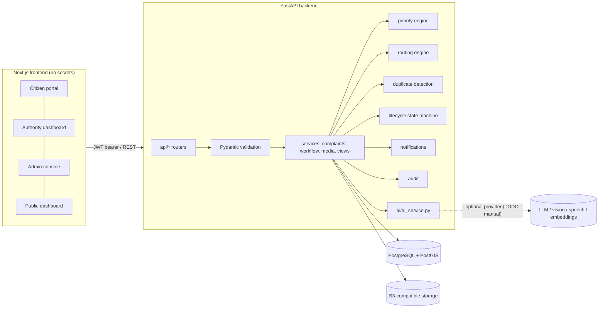

# CivicConnect architecture

## Primary flow

1. Citizen uploads media → `POST /api/media/upload` (magic-byte sniffing, Pillow decode, duration via
   mutagen/ffprobe, size/count limits) → stored privately, unattached.
2. Optional `POST /api/complaints/analyze` → `ai_service` (stub ⇒ 503 `AI_NOT_CONFIGURED`). Never creates a complaint.
3. Citizen confirms → `POST /api/complaints` (idempotency key) runs in one transaction:
   validation → complaint + `SUBMITTED` history → priority assessment → routing decision →
   duplicate suggestions → notifications → audit.
4. Department staff: accept (`UNDER_REVIEW`) → assign officer (`ASSIGNED`) → `IN_PROGRESS` →
   evidence → `RESOLVED_AWAITING_VERIFICATION`.
5. Citizen feedback: `CONFIRMED_RESOLVED` (signal only) or `NOT_RESOLVED`/`REOPEN_REQUEST` (PENDING review item).
6. Department admin / system admin decides reopening, and verifies (`VERIFIED_RESOLVED`) with reason + evidence.
7. Staff approve a privacy-reviewed public summary → public endpoints expose whitelisted fields with rounded coordinates.

## Deterministic rules

**Priority (L6)** – `P = 0.30S + 0.25R + 0.20L + 0.15E + 0.10D`, weights/thresholds versioned in
`priority_configs`. Factor sources: citizen selections mapped to rubric bands (S, R, E), admin-configured sensitive
locations (L), citizen occurrence date through configured duration bands (D), or human-confirmed values from staff.
Any missing factor ⇒ score `null`, status `PROVISIONAL`/`UNAVAILABLE`. Safety risk ≥ 76 ⇒ `needs_prompt_review`.

**Routing (L8)** – PostGIS `ST_Covers` finds containing jurisdictions; eligible = active departments linked to
those jurisdictions with an active **verified** rule for the category.

| Situation | Result |
|---|---|
| exactly one eligible department | `ROUTED` (department stored; lifecycle unchanged; no officer assigned) |
| several eligible | `PENDING_REVIEW` / `MULTIPLE_DEPARTMENTS` |
| outside all configured jurisdictions | `PENDING_REVIEW` / `OUTSIDE_JURISDICTION` |
| GPS accuracy worse than `ROUTING_MAX_LOCATION_ACCURACY_M` | `PENDING_REVIEW` / `LOCATION_UNCERTAIN` |
| none eligible but an unverified/inactive rule or inactive dept could be fixed | `PENDING_REVIEW` / `INCOMPLETE_CONFIGURATION` |
| none eligible and nothing actionable / no jurisdictions configured | `UNROUTED` |

**Duplicates (L7)** – candidates within 100 m, previous 30 days, same/compatible category; text similarity by
embeddings (≥0.85) when configured, otherwise labelled deterministic lexical cosine. Suggestions only.

**Lifecycle (L9)** – `app/services/lifecycle.py`. `ASSIGNED`, `VERIFIED_RESOLVED` and `REOPENED` can only be reached
through their dedicated workflows. Reasons required for `REJECTED`, `ON_HOLD`, reassignment. Optimistic concurrency
via `complaints.version` + row locks. History rows are insert-only.

**Permissions** – CITIZEN: own complaints. OFFICER/DEPARTMENT_ADMIN: complaints routed to their (active) department.
`VERIFY_RESOLUTION` and `DECIDE_REOPENING`: department admins (own department) and system admins by default;
officers only by explicit grant. Out-of-scope complaint IDs return 404 (existence not revealed).

## Data model

users, user_permissions, revoked_tokens, departments, officers, jurisdictions (+ jurisdiction_departments),
responsibility_rules, sensitive_locations, priority_configs, complaints, priority_assessments, routing_decisions,
media, ai_analyses, complaint_relationships, assignments, status_history, complaint_remarks, resolution_evidence,
verification_decisions, citizen_feedback, notifications, audit_logs. Schema: `backend/migrations/versions/`.
